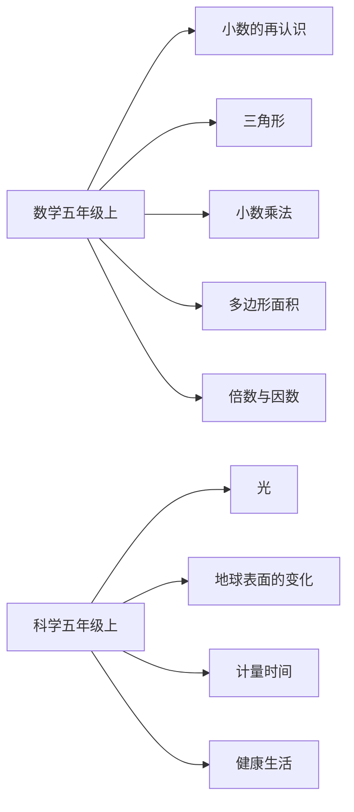

# 五年级上册数学与科学知识图谱（阅读版）

## 1. 来源与分析口径

- 数学：北师大版《义务教育教科书 数学 五年级上册》。
- 科学：教科版《义务教育教科书 科学 五年级上册》。
- 课标：2022年版、2025年修订的数学、科学课程标准，只取5—6年级，不把整个学段写成本册已学。
- 页码用教材目录的书内页。PDF 阅读器页码这次没有核对，所以不写。
- 科学教材文本有识别错误，知识点来自目录、聚焦、研讨和能读通的结论。

## 2. 节点和关系

层级是学科、领域、单元、课次、知识点。方法、课标、核心素养和跨学科主题横向连接。
`stage_later` 表示5—6年级要求里本册还没系统学的内容。

## 3. 总览

## 4. 单元

| 单元 | 来源 |
| --- | --- |
| 第一单元 小数的再认识和加减法 | 数学教材书内2—20｜第一单元 |
| 第二单元 三角形的再认识 | 数学教材书内21—30｜第二单元 |
| 综合实践 小小设计师 | 数学教材书内31—34｜小小设计师 |
| 第三单元 小数乘法 | 数学教材书内35—49｜第三单元 |
| 第四单元 用字母表示（一） | 数学教材书内50—59｜第四单元 |
| 第五单元 多边形的面积 | 数学教材书内60—79｜第五单元 |
| 数学好玩 鸡兔同笼 | 数学教材书内80—81｜鸡兔同笼 |
| 第六单元 图形的位置与运动（一） | 数学教材书内82—88｜第六单元 |
| 第七单元 倍数与因数 | 数学教材书内89—101｜第七单元 |
| 第八单元 可能性 | 数学教材书内102—108｜第八单元 |
| 综合实践 多少落叶能铺满 | 数学教材书内109—112｜多少落叶能铺满 |
| 总复习 | 数学教材书内113—120｜总复习 |
| 第一单元 光 | 科学教材书内2—20｜光 |
| 第二单元 地球表面的变化 | 科学教材书内21—39｜地球表面的变化 |
| 第三单元 计量时间 | 科学教材书内40—57｜计量时间 |
| 第四单元 健康生活 | 科学教材书内58—76｜健康生活 |

## 5. 学习进阶

- 小数的计数单位，先于小数比较、小数加减和小数乘法。
- 多边形面积公式和估计不规则图形面积，用在「多少落叶能铺满」。
- 光沿直线传播，先于影子；光的反射，先于制作潜望镜。
- 和三年级上册的衔接只连真正接得上的内容：认识小数接到小数的再认识，小数比较接到比大小，小数点对齐接到小数加减，两位数乘法接到小数乘法。

## 6. 跨学科

- 健康生活里的体质标准用小数写出体重指数范围，对应数学的小数意义和比大小。
- 摆的快慢实验要记录并比较一定时间内的摆动次数，对应数学里比较数量。
- 光、地球表面变化和数学没有另建边。

## 7. 本册未覆盖的5—6年级要求

分数及其四则运算，比和比例，圆与圆周率，体积和常见立体图形，折线统计图、扇形统计图和百分数，岩石与矿物，雨雪雾的成因，地球自转公转和月相。这些都标成 `stage_later`。

## 8. 限制

- 数学课次页码用的是单元范围，不是每一课的起始页。
- 光的折射是教材明确写出的，5—6年级课标对应条目写的是反射，所以标成超出本学段最低要求。
- 摆的等时和计时工具在5—6年级课标里没有单独条目，不写成直接对应。
