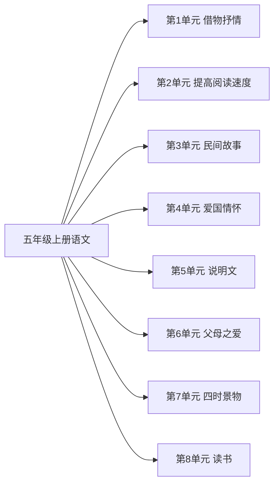

# 五年级上册语文知识图谱（阅读版）

## 1. 来源与分析口径

- 教材：五年级上语文.md。人民教育出版社义务教育教科书
- 课标：（3）义务教育语文课程标准日常修订版（2022年版2025年修订）.md
- 页码：书内页来自教材目录和课题页。这些 Markdown 没有可靠的 PDF 页码，不编造 PDF 页。
- 口径：按本册所在学段对齐。学段里本册尚未系统完成的要求标为 stage_later。

## 2. 图谱模型

节点按学科、领域、单元、课次、知识点展开。方法技能、课标要求和核心素养横向连接。
`current_book` 是本册实际出现的内容。`stage_later` 是同学段里本册还没有系统学习的要求。
`standard_missing` 表示没有对应课标文件，不补写课标条文。

## 3. 总体知识图谱

## 4. 教材知识点与课标对齐

| 单元 | 课次 | 知识点 | 课标对齐 | 状态 | 来源 |
|---|---|---|---|---|---|
| 第1单元 借物抒情 | 桂花雨 | — | 在阅读中了解文章的表达顺序，体会作者的思想感情，初步领悟文章的基本表达方法（partial） | current_book | 五年级上语文.md书内2｜桂花雨 |
| 第1单元 借物抒情 | 落花生 | — | 在阅读中了解文章的表达顺序，体会作者的思想感情，初步领悟文章的基本表达方法（partial） | current_book | 五年级上语文.md书内5｜落花生 |
| 第1单元 借物抒情 | 珍珠鸟 | — | 在阅读中了解文章的表达顺序，体会作者的思想感情，初步领悟文章的基本表达方法（partial） | current_book | 五年级上语文.md书内7｜珍珠鸟 |
| 第1单元 借物抒情 | 口语交际：制定班级公约 | — | 在阅读中了解文章的表达顺序，体会作者的思想感情，初步领悟文章的基本表达方法（partial） | current_book | 五年级上语文.md书内9｜口语交际：制定班级公约 |
| 第1单元 借物抒情 | 习作：我的心爱之物 | — | 在阅读中了解文章的表达顺序，体会作者的思想感情，初步领悟文章的基本表达方法（partial） | current_book | 五年级上语文.md书内10｜习作：我的心爱之物 |
| 第2单元 提高阅读速度 | 冀中的地道战 | — | 默读有一定的速度，学习浏览，根据需要搜集信息（partial） | current_book | 五年级上语文.md书内14｜冀中的地道战 |
| 第2单元 提高阅读速度 | 将相和 | — | 默读有一定的速度，学习浏览，根据需要搜集信息（partial） | current_book | 五年级上语文.md书内17｜将相和 |
| 第2单元 提高阅读速度 | 什么比猎豹的速度更快 | — | 默读有一定的速度，学习浏览，根据需要搜集信息（partial） | current_book | 五年级上语文.md书内22｜什么比猎豹的速度更快 |
| 第2单元 提高阅读速度 | 诺曼底号遇难记 | — | 默读有一定的速度，学习浏览，根据需要搜集信息（partial） | current_book | 五年级上语文.md书内25｜诺曼底号遇难记 |
| 第2单元 提高阅读速度 | 习作：漫画老师 | — | 默读有一定的速度，学习浏览，根据需要搜集信息（partial） | current_book | 五年级上语文.md书内30｜习作：漫画老师 |
| 第3单元 民间故事 | 猎人海力布 | — | 复述印象深刻的故事情节，尝试富有创意地表达（partial） | current_book | 五年级上语文.md书内34｜猎人海力布 |
| 第3单元 民间故事 | 牛郎织女（一） | — | 复述印象深刻的故事情节，尝试富有创意地表达（partial） | current_book | 五年级上语文.md书内37｜牛郎织女（一） |
| 第3单元 民间故事 | 牛郎织女（二） | — | 复述印象深刻的故事情节，尝试富有创意地表达（partial） | current_book | 五年级上语文.md书内42｜牛郎织女（二） |
| 第3单元 民间故事 | 习作：故事新编 | — | 复述印象深刻的故事情节，尝试富有创意地表达（partial） | current_book | 五年级上语文.md书内46｜习作：故事新编 |
| 第3单元 民间故事 | 快乐读书吧：从前有座山 | — | 复述印象深刻的故事情节，尝试富有创意地表达（partial） | current_book | 五年级上语文.md书内49｜快乐读书吧：从前有座山 |
| 第4单元 爱国情怀 | 古诗三首 | — | 初步了解查找资料、运用资料的基本方法（partial） | current_book | 五年级上语文.md书内52｜古诗三首 |
| 第4单元 爱国情怀 | 少年中国说（节选） | — | 初步了解查找资料、运用资料的基本方法（partial） | current_book | 五年级上语文.md书内54｜少年中国说（节选） |
| 第4单元 爱国情怀 | 圆明园的毁灭 | — | 初步了解查找资料、运用资料的基本方法（partial） | current_book | 五年级上语文.md书内56｜圆明园的毁灭 |
| 第4单元 爱国情怀 | 彩色的翅膀 | — | 初步了解查找资料、运用资料的基本方法（partial） | current_book | 五年级上语文.md书内59｜彩色的翅膀 |
| 第4单元 爱国情怀 | 梅兰芳蓄须明志 | — | 初步了解查找资料、运用资料的基本方法（partial） | current_book | 五年级上语文.md书内62｜梅兰芳蓄须明志 |
| 第4单元 爱国情怀 | 习作：二十年后的家乡 | — | 初步了解查找资料、运用资料的基本方法（partial） | current_book | 五年级上语文.md书内65｜习作：二十年后的家乡 |
| 第5单元 说明文 | 太阳 | — | 阅读说明性文章，能抓住要点，了解文章的基本说明方法（partial） | current_book | 五年级上语文.md书内69｜太阳 |
| 第5单元 说明文 | 金字塔 | — | 阅读说明性文章，能抓住要点，了解文章的基本说明方法（partial） | current_book | 五年级上语文.md书内71｜金字塔 |
| 第5单元 说明文 | 习作：介绍一种事物 | — | 阅读说明性文章，能抓住要点，了解文章的基本说明方法（partial） | current_book | 五年级上语文.md书内74｜习作：介绍一种事物 |
| 第6单元 父母之爱 | 慈母情深 | — | 未对齐 | current_book | 五年级上语文.md书内79｜慈母情深 |
| 第6单元 父母之爱 | 父爱之舟 | — | 未对齐 | current_book | 五年级上语文.md书内83｜父爱之舟 |
| 第6单元 父母之爱 | 航天员写给孩子的信 | — | 未对齐 | current_book | 五年级上语文.md书内87｜航天员写给孩子的信 |
| 第6单元 父母之爱 | 口语交际：父母之爱 | — | 未对齐 | current_book | 五年级上语文.md书内90｜口语交际：父母之爱 |
| 第6单元 父母之爱 | 习作：我想对您说 | — | 未对齐 | current_book | 五年级上语文.md书内91｜习作：我想对您说 |
| 第7单元 四时景物 | 古诗三首 | — | 未对齐 | current_book | 五年级上语文.md书内95｜古诗三首 |
| 第7单元 四时景物 | 第一场雪 | — | 未对齐 | current_book | 五年级上语文.md书内97｜第一场雪 |
| 第7单元 四时景物 | 白鹭 | — | 未对齐 | current_book | 五年级上语文.md书内99｜白鹭 |
| 第7单元 四时景物 | 习作：即景 | — | 未对齐 | current_book | 五年级上语文.md书内101｜习作：即景 |
| 第8单元 读书 | 古人谈读书 | — | 未对齐 | current_book | 五年级上语文.md书内105｜古人谈读书 |
| 第8单元 读书 | 忆读书 | — | 未对齐 | current_book | 五年级上语文.md书内107｜忆读书 |
| 第8单元 读书 | 走遍天下书为侣 | — | 未对齐 | current_book | 五年级上语文.md书内112｜走遍天下书为侣 |
| 第8单元 读书 | 习作：写读后感 | — | 未对齐 | current_book | 五年级上语文.md书内114｜习作：写读后感 |

## 5. 学习进阶与前置关系

本册内部的前后关系体现在单元顺序。跨册进阶写在总图里。

## 6. 跨学科关联

跨学科边只在总图中建立，且只连接教材内容确实相关的课。

## 7. 本册未覆盖的学段后续要求

- 本册未单列完成：累计认识常用汉字3000个左右，其中2500个左右会写
- 本册未系统教学：能用毛笔书写楷书
- 本册未核验：默读一般读物每分钟不少于300字
- 本册未系统教学：辨别词语的感情色彩
- 本册未系统教学：体会顿号与逗号、分号与句号的不同用法
- 本册未系统教学：阅读简单的非连续性文本
- 本册未核验：课外阅读总量不少于100万字
- 本册未系统教学：修改自己的习作，并主动与他人交换修改
- 本册未系统教学：尝试写简单的研究报告
- 本册未系统教学：学写活动计划和活动总结
- 本册未系统教学：分类整理学过的字词

## 8. 结论与限制

语文课标是 2022 年版、2025 年修订。四年级上对齐第二学段（3～4年级），五、六年级上对齐第三学段（5～6年级）。学段要求跨学期，本册没有系统安排的条目标为 stage_later，不写成已经掌握。知识点仍只采用教材单元导语和课题里写出的学习要求。六年级文言文相对第三学段最低要求标为 extension。
