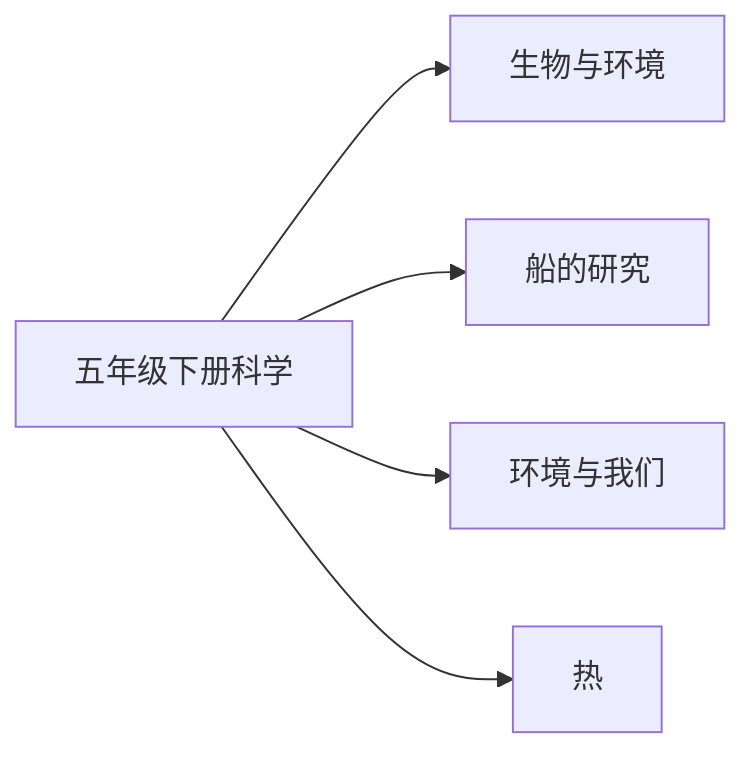

# 五年级下册科学知识图谱（阅读版）

## 1. 来源与分析口径

- 教材：五年级下科学.md。教育科学出版社义务教育教科书
- 课标：（10）义务教育科学课程标准日常修订版（2022年版2025年修订）.md
- 页码：书内页来自教材目录和课题页。这些 Markdown 没有可靠的 PDF 页码，不编造 PDF 页。
- 口径：课次与目录、正文课题一致。对齐状态按该册所在学段的内容要求判断。

## 2. 图谱模型

节点按学科、领域、单元、课次、知识点展开。方法技能、课标要求和核心素养横向连接。
`current_book` 是本册实际出现的内容。`stage_later` 是同学段里本册还没有系统学习的要求。
`standard_missing` 表示没有对应课标文件，不补写课标条文。

## 3. 总体知识图谱

## 4. 教材知识点与课标对齐

| 单元 | 课次 | 知识点 | 课标对齐 | 状态 | 来源 |
|---|---|---|---|---|---|
| 生物与环境 | 种子发芽实验 | 种子发芽实验 | 举例说出动物在环境变化时的行为；知道植物利用阳光、空气和水分制造养分（direct） | current_book | 五年级下科学.md书内2｜种子发芽实验 |
| 生物与环境 | 比较种子发芽实验 | 比较种子发芽实验 | 举例说出动物在环境变化时的行为；知道植物利用阳光、空气和水分制造养分（direct） | current_book | 五年级下科学.md书内4｜比较种子发芽实验 |
| 生物与环境 | 绿豆苗的生长 | 绿豆苗的生长 | 举例说出动物在环境变化时的行为；知道植物利用阳光、空气和水分制造养分（direct） | current_book | 五年级下科学.md书内6｜绿豆苗的生长 |
| 生物与环境 | 蚯蚓的选择 | 蚯蚓的选择 | 举例说出动物在环境变化时的行为；知道植物利用阳光、空气和水分制造养分（direct） | current_book | 五年级下科学.md书内8｜蚯蚓的选择 |
| 生物与环境 | 当环境改变了 | 当环境改变了 | 举例说出动物在环境变化时的行为；知道植物利用阳光、空气和水分制造养分（direct） | current_book | 五年级下科学.md书内11｜当环境改变了 |
| 生物与环境 | 食物链和食物网 | 食物链和食物网 | 举例说出动物在环境变化时的行为；知道植物利用阳光、空气和水分制造养分（extension） | current_book | 五年级下科学.md书内13｜食物链和食物网 |
| 生物与环境 | 设计和制作生态瓶 | 设计和制作生态瓶 | 举例说出动物在环境变化时的行为；知道植物利用阳光、空气和水分制造养分（extension） | current_book | 五年级下科学.md书内17｜设计和制作生态瓶 |
| 船的研究 | 船的历史 | 船的历史 | 观察常见材料在水中的沉浮，知道工程以科学和技术为基础（direct） | current_book | 五年级下科学.md书内21｜船的历史 |
| 船的研究 | 用浮的材料造船 | 用浮的材料造船 | 观察常见材料在水中的沉浮，知道工程以科学和技术为基础（direct） | current_book | 五年级下科学.md书内24｜用浮的材料造船 |
| 船的研究 | 用沉的材料造船 | 用沉的材料造船 | 观察常见材料在水中的沉浮，知道工程以科学和技术为基础（direct） | current_book | 五年级下科学.md书内26｜用沉的材料造船 |
| 船的研究 | 增加船的载重量 | 增加船的载重量 | 观察常见材料在水中的沉浮，知道工程以科学和技术为基础（direct） | current_book | 五年级下科学.md书内29｜增加船的载重量 |
| 船的研究 | 给船装上动力 | 给船装上动力 | 观察常见材料在水中的沉浮，知道工程以科学和技术为基础（direct） | current_book | 五年级下科学.md书内31｜给船装上动力 |
| 船的研究 | 设计我们的小船 | 设计我们的小船 | 观察常见材料在水中的沉浮，知道工程以科学和技术为基础（direct） | current_book | 五年级下科学.md书内33｜设计我们的小船 |
| 船的研究 | 制作与测试我们的小船 | 制作与测试我们的小船 | 观察常见材料在水中的沉浮，知道工程以科学和技术为基础（direct） | current_book | 五年级下科学.md书内35｜制作与测试我们的小船 |
| 环境与我们 | 地球——宇宙的奇迹 | 地球——宇宙的奇迹 | 区分可再生资源和不可再生资源，说明人类活动对环境的影响（direct） | current_book | 五年级下科学.md书内39｜地球——宇宙的奇迹 |
| 环境与我们 | 我们面临的环境问题 | 我们面临的环境问题 | 区分可再生资源和不可再生资源，说明人类活动对环境的影响（direct） | current_book | 五年级下科学.md书内41｜我们面临的环境问题 |
| 环境与我们 | 珍惜水资源 | 珍惜水资源 | 区分可再生资源和不可再生资源，说明人类活动对环境的影响（direct） | current_book | 五年级下科学.md书内43｜珍惜水资源 |
| 环境与我们 | 解决垃圾问题 | 解决垃圾问题 | 区分可再生资源和不可再生资源，说明人类活动对环境的影响（direct） | current_book | 五年级下科学.md书内46｜解决垃圾问题 |
| 环境与我们 | 合理利用能源 | 合理利用能源 | 区分可再生资源和不可再生资源，说明人类活动对环境的影响（direct） | current_book | 五年级下科学.md书内49｜合理利用能源 |
| 环境与我们 | 让资源再生 | 让资源再生 | 区分可再生资源和不可再生资源，说明人类活动对环境的影响（direct） | current_book | 五年级下科学.md书内52｜让资源再生 |
| 环境与我们 | 分析一个实际的环境问题 | 分析一个实际的环境问题 | 区分可再生资源和不可再生资源，说明人类活动对环境的影响（direct） | current_book | 五年级下科学.md书内54｜分析一个实际的环境问题 |
| 热 | 温度与水的变化 | 温度与水的变化 | 热从温度高的物体传向温度低的物体，举例说明影响热传递的主要因素（direct） | current_book | 五年级下科学.md书内58｜温度与水的变化 |
| 热 | 水的蒸发和凝结 | 水的蒸发和凝结 | 热从温度高的物体传向温度低的物体，举例说明影响热传递的主要因素（direct） | current_book | 五年级下科学.md书内61｜水的蒸发和凝结 |
| 热 | 温度不同的物体相互接触 | 温度不同的物体相互接触 | 热从温度高的物体传向温度低的物体，举例说明影响热传递的主要因素（direct） | current_book | 五年级下科学.md书内63｜温度不同的物体相互接触 |
| 热 | 热在金属中的传递 | 热在金属中的传递 | 热从温度高的物体传向温度低的物体，举例说明影响热传递的主要因素（direct） | current_book | 五年级下科学.md书内65｜热在金属中的传递 |
| 热 | 热在水中的传递 | 热在水中的传递 | 热从温度高的物体传向温度低的物体，举例说明影响热传递的主要因素（direct） | current_book | 五年级下科学.md书内68｜热在水中的传递 |
| 热 | 哪个传热快 | 哪个传热快 | 热从温度高的物体传向温度低的物体，举例说明影响热传递的主要因素（direct） | current_book | 五年级下科学.md书内70｜哪个传热快 |
| 热 | 做个保温杯 | 做个保温杯 | 热从温度高的物体传向温度低的物体，举例说明影响热传递的主要因素（direct） | current_book | 五年级下科学.md书内73｜做个保温杯 |

## 5. 学习进阶与前置关系

本册内部的前后关系体现在单元顺序。跨册进阶写在总图里。

## 6. 跨学科关联

食物链和食物网在 7～9 年级才系统要求物质和能量沿食物链流动，本册标为 extension。总图把珍惜水资源、环境问题连到数学节水方案和语文《只有一个地球》。

## 7. 本册未覆盖的学段后续要求

- 本册未学：细胞和微生物
- 本册未学：地球自转、公转和月相
- 本册未学：岩石由矿物组成，火山和地震

## 8. 结论与限制

科学教材为教育科学出版社义务教育教科书。课标按六三学制 3～4 年级或 5～6 年级内容要求对齐。课次名称取自目录并在正文课题中出现。没有把练习情境写成核心知识点。
