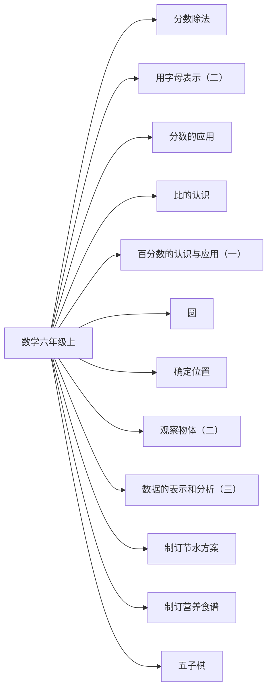

# 六年级上册数学知识图谱（阅读版）

## 1. 来源与分析口径

- 教材：六年级上数学.md。北京师范大学出版社组织编写，封面为 2026 秋季新教材
- 课标：（5）义务教育数学课程标准日常修订版（2022年版2025年修订）.md
- 页码：书内页来自教材目录和课题页。这些 Markdown 没有可靠的 PDF 页码，不编造 PDF 页。
- 口径：对齐 5～6 年级内容要求。本册没有系统学习的同学段要求标为 stage_later。

## 2. 图谱模型

节点按学科、领域、单元、课次、知识点展开。方法技能、课标要求和核心素养横向连接。
`current_book` 是本册实际出现的内容。`stage_later` 是同学段里本册还没有系统学习的要求。
`standard_missing` 表示没有对应课标文件，不补写课标条文。

## 3. 总体知识图谱

## 4. 教材知识点与课标对齐

| 单元 | 课次 | 知识点 | 课标对齐 | 状态 | 来源 |
|---|---|---|---|---|---|
| 分数除法 | 分数除法（一） | 分数除以整数，等于乘这个整数的倒数 | 能进行简单的分数四则运算，理解整数除法与分数的关系（direct） | current_book | 六年级上数学.md书内2｜分数除法（一） |
| 分数除法 | 分数除法（二）（三） | 分数除法和分数乘法、整数除法有联系 | 能进行简单的分数四则运算，理解整数除法与分数的关系（direct） | current_book | 六年级上数学.md书内2｜分数除法（二）（三） |
| 用字母表示（二） | 用字母表示数量关系 | 用字母表示数量关系、规律和图形公式 | 探索用字母表示事物的关系、性质和规律（direct） | current_book | 六年级上数学.md书内33｜用字母表示数量关系 |
| 分数的应用 | 分数的应用 | 一个量是另一个量的几分之几时，可以分步求出未知量 | 能进行简单的分数四则运算，理解整数除法与分数的关系（direct） | current_book | 六年级上数学.md书内49｜分数的应用 |
| 比的认识 | 生活中的比 | 比表示两个数量的倍数关系，比值可以由除法得到 | 在实际情境中理解比和比例，能解决简单问题（partial） | current_book | 六年级上数学.md书内57｜生活中的比 |
| 比的认识 | 比的化简 | 比的前项和后项同时乘或除以同一个不为 0 的数，比值不变 | 在实际情境中理解比和比例，能解决简单问题（partial） | current_book | 六年级上数学.md书内57｜比的化简 |
| 百分数的认识与应用（一） | 百分数的意义 | 百分数表示一个数是另一个数的百分之几，也可以表示部分与整体的关系 | 探索百分数的意义，解决与百分数有关的简单实际问题（direct） | current_book | 六年级上数学.md书内75｜百分数的意义 |
| 圆 | 车轮为什么是圆的 | 圆上各点到圆心的距离相等，所以车轮做成圆形 | 认识圆和扇形，认识圆周率，探索圆的周长和面积（direct） | current_book | 六年级上数学.md书内11｜车轮为什么是圆的 |
| 圆 | 圆的认识 | 圆有圆心、半径和直径，直径等于半径的 2 倍，圆是轴对称图形 | 认识圆和扇形，认识圆周率，探索圆的周长和面积（direct） | current_book | 六年级上数学.md书内11｜圆的认识 |
| 圆 | 圆的周长 | 圆的周长公式是 C=πd 或 C=2πr | 认识圆和扇形，认识圆周率，探索圆的周长和面积（direct） | current_book | 六年级上数学.md书内11｜圆的周长 |
| 圆 | 圆的面积 | 把圆分成扇形再拼成近似平行四边形，探索圆的面积 | 认识圆和扇形，认识圆周率，探索圆的周长和面积（direct） | current_book | 六年级上数学.md书内11｜圆的面积 |
| 确定位置 | 象群北迁 | 用方向描述位置，例如东北方向 | 根据参照点的方向和距离确定位置，用有序数对表示点的位置（direct） | current_book | 六年级上数学.md书内67｜象群北迁 |
| 确定位置 | 用数对确定位置 | 用数对表示方格图上的位置，需要两个要素 | 根据参照点的方向和距离确定位置，用有序数对表示点的位置（direct） | current_book | 六年级上数学.md书内67｜用数对确定位置 |
| 观察物体（二） | 有趣的投影 | 从上面、正面和侧面观察圆柱和圆锥，看到的形状不同 | 辨认简单物体前面、侧面、上面的形状图（direct） | current_book | 六年级上数学.md书内86｜有趣的投影 |
| 数据的表示和分析（三） | 选择统计图 | 折线统计图反映变化情况，扇形统计图表示各部分占总体的百分比 | 认识折线统计图、扇形统计图，解释所表达的意义（direct） | current_book | 六年级上数学.md书内91｜选择统计图 |
| 制订节水方案 | 调查用水并做滴水实验 | 调查用水情况，用滴水实验的数据制订节水方案 | 认识折线统计图、扇形统计图，解释所表达的意义（partial） | current_book | 六年级上数学.md书内44｜调查用水并做滴水实验 |
| 制订营养食谱 | 一日三餐 | 用扇形统计图整理饮食调查，分析怎样实现营养均衡 | 探索百分数的意义，解决与百分数有关的简单实际问题（partial） | current_book | 六年级上数学.md书内103｜一日三餐 |
| 五子棋 | 五子棋的规则 | 五子棋双方轮流落子，先把五子连成一条直线的一方获胜 | 根据参照点的方向和距离确定位置，用有序数对表示点的位置（extension） | current_book | 六年级上数学.md书内73｜五子棋的规则 |

## 5. 学习进阶与前置关系

- 分数除以整数，等于乘这个整数的倒数 前置于 一个量是另一个量的几分之几时，可以分步求出未知量
- 圆有圆心、半径和直径，直径等于半径的 2 倍，圆是轴对称图形 前置于 圆的周长公式是 C=πd 或 C=2πr
- 圆的周长公式是 C=πd 或 C=2πr 前置于 把圆分成扇形再拼成近似平行四边形，探索圆的面积
- 比表示两个数量的倍数关系，比值可以由除法得到 前置于 比的前项和后项同时乘或除以同一个不为 0 的数，比值不变
- 百分数表示一个数是另一个数的百分之几，也可以表示部分与整体的关系 前置于 折线统计图反映变化情况，扇形统计图表示各部分占总体的百分比

## 6. 跨学科关联

总图把制订节水方案、制订营养食谱、车轮为什么是圆的，分别连到科学相应课次。

## 7. 本册未覆盖的学段后续要求

- 本册未学：2、3、5的倍数特征，公因数、公倍数，质数和合数
- 本册未学：成正比的量，以及按比例分配
- 本册未学：长方体、正方体、圆柱、圆锥的体积和表面积
- 本册未学：比例尺，以及方格纸上的平移、旋转和轴对称
- 本册未学：随机现象发生的可能性

## 8. 结论与限制

数学教材封面写明 2026 秋季新教材，课标是 2022 年版、2025 年修订。主题一致不等于逐条完全覆盖。Markdown 由教材转换而来，表格和个别标题有识别误差，知识点以正文和「我的收获」核对过的表述为准。
