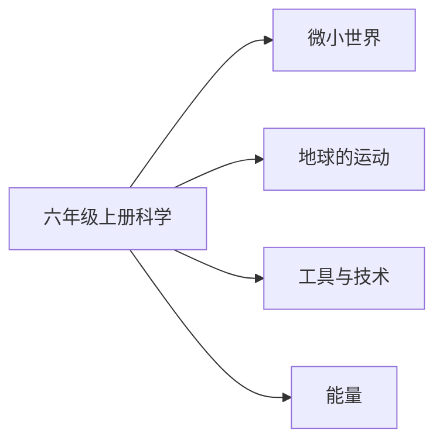

# 六年级上册科学知识图谱（阅读版）

## 1. 来源与分析口径

- 教材：六年级上科学.md。教育科学出版社义务教育教科书
- 课标：（10）义务教育科学课程标准日常修订版（2022年版2025年修订）.md
- 页码：书内页来自教材目录和课题页。这些 Markdown 没有可靠的 PDF 页码，不编造 PDF 页。
- 口径：课次与目录、正文课题一致。对齐状态按该册所在学段的内容要求判断。

## 2. 图谱模型

节点按学科、领域、单元、课次、知识点展开。方法技能、课标要求和核心素养横向连接。
`current_book` 是本册实际出现的内容。`stage_later` 是同学段里本册还没有系统学习的要求。
`standard_missing` 表示没有对应课标文件，不补写课标条文。

## 3. 总体知识图谱

## 4. 教材知识点与课标对齐

| 单元 | 课次 | 知识点 | 课标对齐 | 状态 | 来源 |
|---|---|---|---|---|---|
| 微小世界 | 放大镜 | 放大镜 | 知道细胞是生物体结构与生命活动的基本单位，列举常见微生物（direct） | current_book | 六年级上科学.md书内2｜放大镜 |
| 微小世界 | 怎样放得更大 | 怎样放得更大 | 知道细胞是生物体结构与生命活动的基本单位，列举常见微生物（direct） | current_book | 六年级上科学.md书内4｜怎样放得更大 |
| 微小世界 | 观察身边微小的物体 | 观察身边微小的物体 | 知道细胞是生物体结构与生命活动的基本单位，列举常见微生物（direct） | current_book | 六年级上科学.md书内6｜观察身边微小的物体 |
| 微小世界 | 观察洋葱表皮细胞 | 观察洋葱表皮细胞 | 知道细胞是生物体结构与生命活动的基本单位，列举常见微生物（direct） | current_book | 六年级上科学.md书内9｜观察洋葱表皮细胞 |
| 微小世界 | 观察更多的生物细胞 | 观察更多的生物细胞 | 知道细胞是生物体结构与生命活动的基本单位，列举常见微生物（direct） | current_book | 六年级上科学.md书内11｜观察更多的生物细胞 |
| 微小世界 | 观察水中微小的生物 | 观察水中微小的生物 | 知道细胞是生物体结构与生命活动的基本单位，列举常见微生物（direct） | current_book | 六年级上科学.md书内14｜观察水中微小的生物 |
| 微小世界 | 微生物与健康 | 微生物与健康 | 知道细胞是生物体结构与生命活动的基本单位，列举常见微生物（direct） | current_book | 六年级上科学.md书内17｜微生物与健康 |
| 地球的运动 | 我们的地球模型 | 我们的地球模型 | 知道地球自转与昼夜交替有关，地球公转与四季形成有关（direct） | current_book | 六年级上科学.md书内21｜我们的地球模型 |
| 地球的运动 | 昼夜交替现象 | 昼夜交替现象 | 知道地球自转与昼夜交替有关，地球公转与四季形成有关（direct） | current_book | 六年级上科学.md书内24｜昼夜交替现象 |
| 地球的运动 | 人类认识地球运动的历史 | 人类认识地球运动的历史 | 知道地球自转与昼夜交替有关，地球公转与四季形成有关（direct） | current_book | 六年级上科学.md书内26｜人类认识地球运动的历史 |
| 地球的运动 | 谁先迎来黎明 | 谁先迎来黎明 | 知道地球自转与昼夜交替有关，地球公转与四季形成有关（direct） | current_book | 六年级上科学.md书内29｜谁先迎来黎明 |
| 地球的运动 | 影长的四季变化 | 影长的四季变化 | 知道地球自转与昼夜交替有关，地球公转与四季形成有关（direct） | current_book | 六年级上科学.md书内31｜影长的四季变化 |
| 地球的运动 | 地球的公转与四季变化 | 地球的公转与四季变化 | 知道地球自转与昼夜交替有关，地球公转与四季形成有关（direct） | current_book | 六年级上科学.md书内33｜地球的公转与四季变化 |
| 地球的运动 | 昼夜和四季变化对生物的影响 | 昼夜和四季变化对生物的影响 | 知道地球自转与昼夜交替有关，地球公转与四季形成有关（direct） | current_book | 六年级上科学.md书内36｜昼夜和四季变化对生物的影响 |
| 工具与技术 | 紧密联系的工具和技术 | 紧密联系的工具和技术 | 知道杠杆、滑轮、轮轴、斜面等简单机械及其应用（direct） | current_book | 六年级上科学.md书内40｜紧密联系的工具和技术 |
| 工具与技术 | 斜面 | 斜面 | 知道杠杆、滑轮、轮轴、斜面等简单机械及其应用（direct） | current_book | 六年级上科学.md书内43｜斜面 |
| 工具与技术 | 不简单的杠杆 | 不简单的杠杆 | 知道杠杆、滑轮、轮轴、斜面等简单机械及其应用（direct） | current_book | 六年级上科学.md书内46｜不简单的杠杆 |
| 工具与技术 | 改变运输的车轮 | 改变运输的车轮 | 知道杠杆、滑轮、轮轴、斜面等简单机械及其应用（direct） | current_book | 六年级上科学.md书内49｜改变运输的车轮 |
| 工具与技术 | 灵活巧妙的剪刀 | 灵活巧妙的剪刀 | 知道杠杆、滑轮、轮轴、斜面等简单机械及其应用（direct） | current_book | 六年级上科学.md书内52｜灵活巧妙的剪刀 |
| 工具与技术 | 推动社会发展的印刷术 | 推动社会发展的印刷术 | 知道杠杆、滑轮、轮轴、斜面等简单机械及其应用（direct） | current_book | 六年级上科学.md书内54｜推动社会发展的印刷术 |
| 工具与技术 | 信息的交流传播 | 信息的交流传播 | 知道杠杆、滑轮、轮轴、斜面等简单机械及其应用（direct） | current_book | 六年级上科学.md书内56｜信息的交流传播 |
| 能量 | 各种形式的能量 | 各种形式的能量 | 知道动能、声能、光能、热能、电能、磁能等能的形式及其转化（direct） | current_book | 六年级上科学.md书内59｜各种形式的能量 |
| 能量 | 调查家中使用的能量 | 调查家中使用的能量 | 知道动能、声能、光能、热能、电能、磁能等能的形式及其转化（direct） | current_book | 六年级上科学.md书内61｜调查家中使用的能量 |
| 能量 | 电和磁 | 电和磁 | 知道动能、声能、光能、热能、电能、磁能等能的形式及其转化（direct） | current_book | 六年级上科学.md书内64｜电和磁 |
| 能量 | 电能和磁能 | 电能和磁能 | 知道动能、声能、光能、热能、电能、磁能等能的形式及其转化（direct） | current_book | 六年级上科学.md书内67｜电能和磁能 |
| 能量 | 电磁铁 | 电磁铁 | 知道动能、声能、光能、热能、电能、磁能等能的形式及其转化（partial） | current_book | 六年级上科学.md书内70｜电磁铁 |
| 能量 | 神奇的小电动机 | 神奇的小电动机 | 知道动能、声能、光能、热能、电能、磁能等能的形式及其转化（partial） | current_book | 六年级上科学.md书内72｜神奇的小电动机 |
| 能量 | 能量从哪里来 | 能量从哪里来 | 知道动能、声能、光能、热能、电能、磁能等能的形式及其转化（direct） | current_book | 六年级上科学.md书内74｜能量从哪里来 |

## 5. 学习进阶与前置关系

本册内部的前后关系体现在单元顺序。跨册进阶写在总图里。

## 6. 跨学科关联

总图把「改变运输的车轮」和数学「车轮为什么是圆的」相连。

## 7. 本册未覆盖的学段后续要求

- 本册未学：太阳系八颗行星和星座
- 本册未学：有些变化会生成新物质

## 8. 结论与限制

科学教材为教育科学出版社义务教育教科书。课标按六三学制 3～4 年级或 5～6 年级内容要求对齐。课次名称取自目录并在正文课题中出现。没有把练习情境写成核心知识点。
