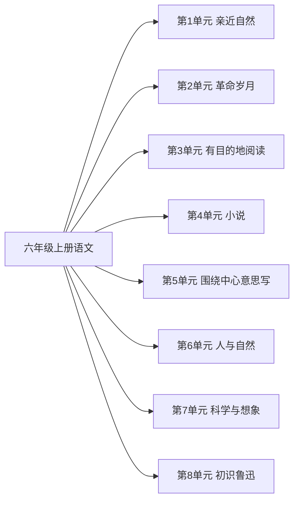

# 六年级上册语文知识图谱（阅读版）

## 1. 来源与分析口径

- 教材：六年级上语文.md。人民教育出版社义务教育教科书
- 课标：（3）义务教育语文课程标准日常修订版（2022年版2025年修订）.md
- 页码：书内页来自教材目录和课题页。这些 Markdown 没有可靠的 PDF 页码，不编造 PDF 页。
- 口径：按本册所在学段对齐。学段里本册尚未系统完成的要求标为 stage_later。

## 2. 图谱模型

节点按学科、领域、单元、课次、知识点展开。方法技能、课标要求和核心素养横向连接。
`current_book` 是本册实际出现的内容。`stage_later` 是同学段里本册还没有系统学习的要求。
`standard_missing` 表示没有对应课标文件，不补写课标条文。

## 3. 总体知识图谱

## 4. 教材知识点与课标对齐

| 单元 | 课次 | 知识点 | 课标对齐 | 状态 | 来源 |
|---|---|---|---|---|---|
| 第1单元 亲近自然 | 草原 | — | 阅读表现人与自然的诗歌、散文，体会人与自然和谐相处的意义（partial） | current_book | 六年级上语文.md书内2｜草原 |
| 第1单元 亲近自然 | 丁香结 | — | 阅读表现人与自然的诗歌、散文，体会人与自然和谐相处的意义（partial） | current_book | 六年级上语文.md书内5｜丁香结 |
| 第1单元 亲近自然 | 古诗词三首 | — | 阅读表现人与自然的诗歌、散文，体会人与自然和谐相处的意义（partial） | current_book | 六年级上语文.md书内8｜古诗词三首 |
| 第1单元 亲近自然 | 习作：变形记 | — | 阅读表现人与自然的诗歌、散文，体会人与自然和谐相处的意义（partial） | current_book | 六年级上语文.md书内10｜习作：变形记 |
| 第2单元 革命岁月 | 七律·长征 | — | 阅读表现革命先烈事迹的诗歌、小说，感受革命先烈伟大的精神世界（direct） | current_book | 六年级上语文.md书内14｜七律·长征 |
| 第2单元 革命岁月 | 狼牙山五壮士 | — | 阅读表现革命先烈事迹的诗歌、小说，感受革命先烈伟大的精神世界（direct） | current_book | 六年级上语文.md书内16｜狼牙山五壮士 |
| 第2单元 革命岁月 | 开国大典 | — | 阅读表现革命先烈事迹的诗歌、小说，感受革命先烈伟大的精神世界（direct） | current_book | 六年级上语文.md书内19｜开国大典 |
| 第2单元 革命岁月 | 我的战友邱少云 | — | 阅读表现革命先烈事迹的诗歌、小说，感受革命先烈伟大的精神世界（direct） | current_book | 六年级上语文.md书内24｜我的战友邱少云 |
| 第2单元 革命岁月 | 口语交际：演讲 | — | 阅读表现革命先烈事迹的诗歌、小说，感受革命先烈伟大的精神世界（direct） | current_book | 六年级上语文.md书内27｜口语交际：演讲 |
| 第2单元 革命岁月 | 习作：多彩的活动 | — | 阅读表现革命先烈事迹的诗歌、小说，感受革命先烈伟大的精神世界（direct） | current_book | 六年级上语文.md书内28｜习作：多彩的活动 |
| 第3单元 有目的地阅读 | 竹节人 | — | 学习浏览，根据需要搜集信息（partial） | current_book | 六年级上语文.md书内32｜竹节人 |
| 第3单元 有目的地阅读 | 宇宙生命之谜 | — | 学习浏览，根据需要搜集信息（partial） | current_book | 六年级上语文.md书内36｜宇宙生命之谜 |
| 第3单元 有目的地阅读 | 故宫博物院 | — | 学习浏览，根据需要搜集信息（partial） | current_book | 六年级上语文.md书内40｜故宫博物院 |
| 第3单元 有目的地阅读 | 习作：让生活更美好 | — | 学习浏览，根据需要搜集信息（partial） | current_book | 六年级上语文.md书内46｜习作：让生活更美好 |
| 第4单元 小说 | 桥 | — | 阅读叙事性作品，了解事件梗概，能简单描述印象最深的场景、人物、细节（partial） | current_book | 六年级上语文.md书内50｜桥 |
| 第4单元 小说 | 穷人 | — | 阅读叙事性作品，了解事件梗概，能简单描述印象最深的场景、人物、细节（partial） | current_book | 六年级上语文.md书内53｜穷人 |
| 第4单元 小说 | 金色的鱼钩 | — | 阅读叙事性作品，了解事件梗概，能简单描述印象最深的场景、人物、细节（partial） | current_book | 六年级上语文.md书内58｜金色的鱼钩 |
| 第4单元 小说 | 习作：笔尖流出的故事 | — | 阅读叙事性作品，了解事件梗概，能简单描述印象最深的场景、人物、细节（partial） | current_book | 六年级上语文.md书内64｜习作：笔尖流出的故事 |
| 第4单元 小说 | 快乐读书吧：笑与泪，经历与成长 | — | 阅读叙事性作品，了解事件梗概，能简单描述印象最深的场景、人物、细节（partial） | current_book | 六年级上语文.md书内67｜快乐读书吧：笑与泪，经历与成长 |
| 第5单元 围绕中心意思写 | 灯光 | — | 能写简单的记实作文，内容具体，感情真实，分段表述（partial） | current_book | 六年级上语文.md书内70｜灯光 |
| 第5单元 围绕中心意思写 | 盼 | — | 能写简单的记实作文，内容具体，感情真实，分段表述（partial） | current_book | 六年级上语文.md书内73｜盼 |
| 第5单元 围绕中心意思写 | 习作：围绕中心意思写 | — | 能写简单的记实作文，内容具体，感情真实，分段表述（partial） | current_book | 六年级上语文.md书内77｜习作：围绕中心意思写 |
| 第6单元 人与自然 | 只有一个地球 | — | 未对齐 | current_book | 六年级上语文.md书内82｜只有一个地球 |
| 第6单元 人与自然 | 青山不老 | — | 未对齐 | current_book | 六年级上语文.md书内84｜青山不老 |
| 第6单元 人与自然 | 三黑和土地 | — | 未对齐 | current_book | 六年级上语文.md书内86｜三黑和土地 |
| 第6单元 人与自然 | 古诗三首 | — | 未对齐 | current_book | 六年级上语文.md书内91｜古诗三首 |
| 第6单元 人与自然 | 习作：学写倡议书 | — | 未对齐 | current_book | 六年级上语文.md书内94｜习作：学写倡议书 |
| 第7单元 科学与想象 | 文言文二则 | — | 初步领悟文章的基本表达方法（partial） | current_book | 六年级上语文.md书内98｜文言文二则 |
| 第7单元 科学与想象 | 表里的生物 | — | 初步领悟文章的基本表达方法（partial） | current_book | 六年级上语文.md书内100｜表里的生物 |
| 第7单元 科学与想象 | 他们那时候多有趣啊 | — | 初步领悟文章的基本表达方法（partial） | current_book | 六年级上语文.md书内103｜他们那时候多有趣啊 |
| 第7单元 科学与想象 | 习作：插上科学的翅膀飞 | — | 初步领悟文章的基本表达方法（partial） | current_book | 六年级上语文.md书内106｜习作：插上科学的翅膀飞 |
| 第8单元 初识鲁迅 | 少年闰土 | — | 阅读反映少年成长的故事、小说、传记，交流自己获得的启示（partial） | current_book | 六年级上语文.md书内110｜少年闰土 |
| 第8单元 初识鲁迅 | 好的故事 | — | 阅读反映少年成长的故事、小说、传记，交流自己获得的启示（partial） | current_book | 六年级上语文.md书内114｜好的故事 |
| 第8单元 初识鲁迅 | 我的伯父鲁迅先生 | — | 阅读反映少年成长的故事、小说、传记，交流自己获得的启示（partial） | current_book | 六年级上语文.md书内117｜我的伯父鲁迅先生 |
| 第8单元 初识鲁迅 | 有的人 | — | 阅读反映少年成长的故事、小说、传记，交流自己获得的启示（partial） | current_book | 六年级上语文.md书内121｜有的人 |
| 第8单元 初识鲁迅 | 习作：传承好家风 | — | 阅读反映少年成长的故事、小说、传记，交流自己获得的启示（partial） | current_book | 六年级上语文.md书内123｜习作：传承好家风 |

## 5. 学习进阶与前置关系

本册内部的前后关系体现在单元顺序。跨册进阶写在总图里。

## 6. 跨学科关联

跨学科边只在总图中建立，且只连接教材内容确实相关的课。

## 7. 本册未覆盖的学段后续要求

- 本册未单列完成：累计认识常用汉字3000个左右，其中2500个左右会写
- 本册未系统教学：能用毛笔书写楷书
- 本册未核验：默读一般读物每分钟不少于300字
- 本册未系统教学：辨别词语的感情色彩
- 本册未系统教学：体会顿号与逗号、分号与句号的不同用法
- 本册未系统教学：阅读简单的非连续性文本
- 本册未核验：课外阅读总量不少于100万字
- 本册未系统教学：修改自己的习作，并主动与他人交换修改
- 本册未系统教学：尝试写简单的研究报告
- 本册未系统教学：学写活动计划和活动总结
- 本册未系统教学：分类整理学过的字词

## 8. 结论与限制

语文课标是 2022 年版、2025 年修订。四年级上对齐第二学段（3～4年级），五、六年级上对齐第三学段（5～6年级）。学段要求跨学期，本册没有系统安排的条目标为 stage_later，不写成已经掌握。知识点仍只采用教材单元导语和课题里写出的学习要求。六年级文言文相对第三学段最低要求标为 extension。
