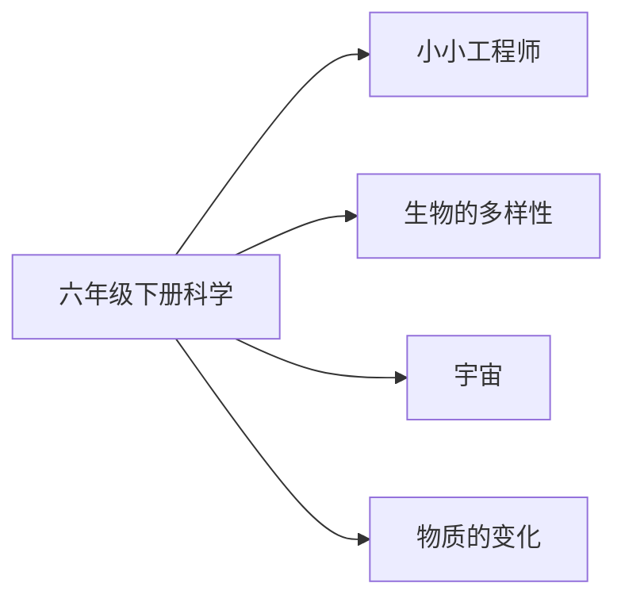

# 六年级下册科学知识图谱（阅读版）

## 1. 来源与分析口径

- 教材：六年级下科学.md。教育科学出版社义务教育教科书
- 课标：（10）义务教育科学课程标准日常修订版（2022年版2025年修订）.md
- 页码：书内页来自教材目录和课题页。这些 Markdown 没有可靠的 PDF 页码，不编造 PDF 页。
- 口径：课次与目录、正文课题一致。对齐状态按该册所在学段的内容要求判断。

## 2. 图谱模型

节点按学科、领域、单元、课次、知识点展开。方法技能、课标要求和核心素养横向连接。
`current_book` 是本册实际出现的内容。`stage_later` 是同学段里本册还没有系统学习的要求。
`standard_missing` 表示没有对应课标文件，不补写课标条文。

## 3. 总体知识图谱

## 4. 教材知识点与课标对齐

| 单元 | 课次 | 知识点 | 课标对齐 | 状态 | 来源 |
|---|---|---|---|---|---|
| 小小工程师 | 了解我们的住房 | 了解我们的住房 | 知道工程以科学和技术为基础，通常由多个系统组成（direct） | current_book | 六年级下科学.md书内2｜了解我们的住房 |
| 小小工程师 | 认识工程 | 认识工程 | 知道工程以科学和技术为基础，通常由多个系统组成（direct） | current_book | 六年级下科学.md书内4｜认识工程 |
| 小小工程师 | 建造塔台 | 建造塔台 | 知道工程以科学和技术为基础，通常由多个系统组成（direct） | current_book | 六年级下科学.md书内8｜建造塔台 |
| 小小工程师 | 设计塔台模型 | 设计塔台模型 | 知道工程以科学和技术为基础，通常由多个系统组成（direct） | current_book | 六年级下科学.md书内10｜设计塔台模型 |
| 小小工程师 | 制作塔台模型 | 制作塔台模型 | 知道工程以科学和技术为基础，通常由多个系统组成（direct） | current_book | 六年级下科学.md书内13｜制作塔台模型 |
| 小小工程师 | 测试塔台模型 | 测试塔台模型 | 知道工程以科学和技术为基础，通常由多个系统组成（direct） | current_book | 六年级下科学.md书内15｜测试塔台模型 |
| 小小工程师 | 评估改进塔台模型 | 评估改进塔台模型 | 知道工程以科学和技术为基础，通常由多个系统组成（direct） | current_book | 六年级下科学.md书内17｜评估改进塔台模型 |
| 生物的多样性 | 校园生物大搜索 | 校园生物大搜索 | 根据特征对植物分类；根据化石说出已灭绝生物，并关注生物多样性保护（direct） | current_book | 六年级下科学.md书内20｜校园生物大搜索 |
| 生物的多样性 | 制作校园生物分布图 | 制作校园生物分布图 | 根据特征对植物分类；根据化石说出已灭绝生物，并关注生物多样性保护（direct） | current_book | 六年级下科学.md书内23｜制作校园生物分布图 |
| 生物的多样性 | 形形色色的植物 | 形形色色的植物 | 根据特征对植物分类；根据化石说出已灭绝生物，并关注生物多样性保护（direct） | current_book | 六年级下科学.md书内26｜形形色色的植物 |
| 生物的多样性 | 多种多样的动物 | 多种多样的动物 | 根据特征对植物分类；根据化石说出已灭绝生物，并关注生物多样性保护（direct） | current_book | 六年级下科学.md书内29｜多种多样的动物 |
| 生物的多样性 | 相貌各异的我们 | 相貌各异的我们 | 根据特征对植物分类；根据化石说出已灭绝生物，并关注生物多样性保护（direct） | current_book | 六年级下科学.md书内32｜相貌各异的我们 |
| 生物的多样性 | 古代生物的多样性 | 古代生物的多样性 | 根据特征对植物分类；根据化石说出已灭绝生物，并关注生物多样性保护（direct） | current_book | 六年级下科学.md书内34｜古代生物的多样性 |
| 生物的多样性 | 保护生物多样性 | 保护生物多样性 | 根据特征对植物分类；根据化石说出已灭绝生物，并关注生物多样性保护（direct） | current_book | 六年级下科学.md书内36｜保护生物多样性 |
| 宇宙 | 太阳系大家庭 | 太阳系大家庭 | 知道太阳是恒星、太阳系有八颗行星，认识大熊座、猎户座等星座（direct） | current_book | 六年级下科学.md书内40｜太阳系大家庭 |
| 宇宙 | 八颗行星 | 八颗行星 | 知道太阳是恒星、太阳系有八颗行星，认识大熊座、猎户座等星座（direct） | current_book | 六年级下科学.md书内43｜八颗行星 |
| 宇宙 | 日食 | 日食 | 知道太阳是恒星、太阳系有八颗行星，认识大熊座、猎户座等星座（direct） | current_book | 六年级下科学.md书内45｜日食 |
| 宇宙 | 认识星座 | 认识星座 | 知道太阳是恒星、太阳系有八颗行星，认识大熊座、猎户座等星座（direct） | current_book | 六年级下科学.md书内47｜认识星座 |
| 宇宙 | 夏季星空 | 夏季星空 | 知道太阳是恒星、太阳系有八颗行星，认识大熊座、猎户座等星座（direct） | current_book | 六年级下科学.md书内49｜夏季星空 |
| 宇宙 | 浩瀚的宇宙 | 浩瀚的宇宙 | 知道太阳是恒星、太阳系有八颗行星，认识大熊座、猎户座等星座（direct） | current_book | 六年级下科学.md书内51｜浩瀚的宇宙 |
| 宇宙 | 探索宇宙 | 探索宇宙 | 知道太阳是恒星、太阳系有八颗行星，认识大熊座、猎户座等星座（direct） | current_book | 六年级下科学.md书内54｜探索宇宙 |
| 物质的变化 | 厨房里的物质与变化 | 厨房里的物质与变化 | 知道有些变化中构成物体的物质也发生了改变，如纸燃烧、铁生锈（direct） | current_book | 六年级下科学.md书内58｜厨房里的物质与变化 |
| 物质的变化 | 产生气体的变化 | 产生气体的变化 | 知道有些变化中构成物体的物质也发生了改变，如纸燃烧、铁生锈（direct） | current_book | 六年级下科学.md书内61｜产生气体的变化 |
| 物质的变化 | 发现变化中的新物质 | 发现变化中的新物质 | 知道有些变化中构成物体的物质也发生了改变，如纸燃烧、铁生锈（direct） | current_book | 六年级下科学.md书内63｜发现变化中的新物质 |
| 物质的变化 | 变化中伴随的现象 | 变化中伴随的现象 | 知道有些变化中构成物体的物质也发生了改变，如纸燃烧、铁生锈（direct） | current_book | 六年级下科学.md书内66｜变化中伴随的现象 |
| 物质的变化 | 地球家园的化学变化 | 地球家园的化学变化 | 知道有些变化中构成物体的物质也发生了改变，如纸燃烧、铁生锈（direct） | current_book | 六年级下科学.md书内68｜地球家园的化学变化 |
| 物质的变化 | 生命体中的化学变化 | 生命体中的化学变化 | 知道有些变化中构成物体的物质也发生了改变，如纸燃烧、铁生锈（direct） | current_book | 六年级下科学.md书内71｜生命体中的化学变化 |
| 物质的变化 | 美丽的化学变化 | 美丽的化学变化 | 知道有些变化中构成物体的物质也发生了改变，如纸燃烧、铁生锈（direct） | current_book | 六年级下科学.md书内73｜美丽的化学变化 |

## 5. 学习进阶与前置关系

本册内部的前后关系体现在单元顺序。跨册进阶写在总图里。

## 6. 跨学科关联

总图把「探索宇宙」和六年级语文《宇宙生命之谜》相连。

## 7. 本册未覆盖的学段后续要求

- 本册未学：用显微镜观察细胞
- 本册未学：地球公转与四季

## 8. 结论与限制

科学教材为教育科学出版社义务教育教科书。课标按六三学制 3～4 年级或 5～6 年级内容要求对齐。课次名称取自目录并在正文课题中出现。没有把练习情境写成核心知识点。
