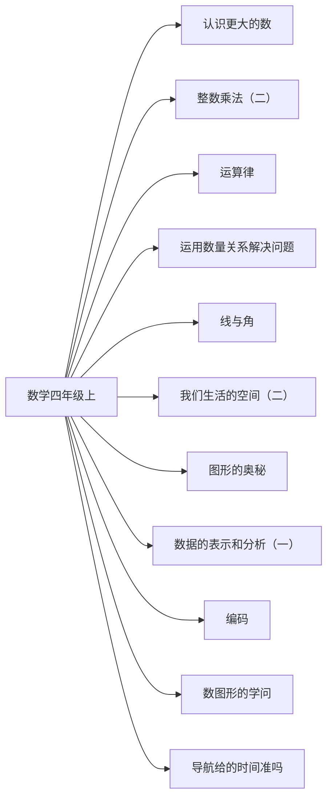

# 四年级上册数学知识图谱（阅读版）

## 1. 来源与分析口径

- 教材：四年级上数学.md。北京师范大学出版社组织编写，封面为 2026 秋季新教材
- 课标：（5）义务教育数学课程标准日常修订版（2022年版2025年修订）.md
- 页码：书内页来自教材目录和课题页。这些 Markdown 没有可靠的 PDF 页码，不编造 PDF 页。
- 口径：只把本册实际出现的内容标为 current_book。3～4 年级里本册没有系统学习的要求标为 stage_later。

## 2. 图谱模型

节点按学科、领域、单元、课次、知识点展开。方法技能、课标要求和核心素养横向连接。
`current_book` 是本册实际出现的内容。`stage_later` 是同学段里本册还没有系统学习的要求。
`standard_missing` 表示没有对应课标文件，不补写课标条文。

## 3. 总体知识图谱

## 4. 教材知识点与课标对齐

| 单元 | 课次 | 知识点 | 课标对齐 | 状态 | 来源 |
|---|---|---|---|---|---|
| 认识更大的数 | 数说祖国 | 读写大数要先按个级、万级、亿级分级 | 在具体情境中认识万以上的数，了解十进制计数法（direct） | current_book | 四年级上数学.md书内2｜数说祖国 |
| 认识更大的数 | 认识更大的数 | 借助数位顺序表认识和读写大数 | 在具体情境中认识万以上的数，了解十进制计数法（direct） | current_book | 四年级上数学.md书内2｜认识更大的数 |
| 认识更大的数 | 人口普查 | 用四舍五入把大数改写成用万或亿作单位的近似数 | 在具体情境中认识万以上的数，了解十进制计数法（direct） | current_book | 四年级上数学.md书内2｜人口普查 |
| 认识更大的数 | 从结绳计数说起 | 了解结绳、玛雅数字和中国算筹等计数方法 | 在具体情境中认识万以上的数，了解十进制计数法（extension） | current_book | 四年级上数学.md书内2｜从结绳计数说起 |
| 整数乘法（二） | 三位数乘两位数 | 三位数乘两位数可以拆成整十数和一位数再相加 | 探索并掌握多位数乘除法；能计算两位数乘三位数（direct） | current_book | 四年级上数学.md书内39｜三位数乘两位数 |
| 整数乘法（二） | 神奇的计算工具 | 计算器是常用计算工具，可以用来计算和核对 | 能借助计算器进行计算，探索简单规律（direct） | current_book | 四年级上数学.md书内39｜神奇的计算工具 |
| 运算律 | 加法交换律和乘法交换律 | 加法交换律和乘法交换律 | 探索并理解运算律，能用字母表示运算律（direct） | current_book | 四年级上数学.md书内63｜加法交换律和乘法交换律 |
| 运算律 | 加法结合律和乘法结合律 | 加法结合律和乘法结合律 | 探索并理解运算律，能用字母表示运算律（direct） | current_book | 四年级上数学.md书内63｜加法结合律和乘法结合律 |
| 运算律 | 乘法分配律 | 乘法分配律 | 探索并理解运算律，能用字母表示运算律（direct） | current_book | 四年级上数学.md书内63｜乘法分配律 |
| 运算律 | 用字母表示运算律 | 尝试用字母表示运算律 | 探索并理解运算律，能用字母表示运算律（partial） | current_book | 四年级上数学.md书内63｜用字母表示运算律 |
| 运用数量关系解决问题 | 总量与分量 | 总量等于各分量之和 | 认识总量等于分量之和、总价等于单价乘数量、路程等于速度乘时间（direct） | current_book | 四年级上数学.md书内85｜总量与分量 |
| 运用数量关系解决问题 | 单价、数量与总价 | 总价等于单价乘数量 | 认识总量等于分量之和、总价等于单价乘数量、路程等于速度乘时间（direct） | current_book | 四年级上数学.md书内85｜单价、数量与总价 |
| 运用数量关系解决问题 | 速度、时间与路程 | 路程等于速度乘时间，速度是单位时间走过的路程 | 认识总量等于分量之和、总价等于单价乘数量、路程等于速度乘时间（direct） | current_book | 四年级上数学.md书内85｜速度、时间与路程 |
| 线与角 | 线的认识 | 线段有两个端点且长度有限，射线有一个端点，直线没有端点 | 结合实例认识线段、射线和直线，了解同一平面内两条直线的位置关系（direct） | current_book | 四年级上数学.md书内23｜线的认识 |
| 线与角 | 相交与垂直 | 同一平面内两条直线相交，其中一种特殊情况是垂直 | 结合实例认识线段、射线和直线，了解同一平面内两条直线的位置关系（direct） | current_book | 四年级上数学.md书内23｜相交与垂直 |
| 线与角 | 平移与平行 | 平移可以得到平行线 | 结合实例感受平移、旋转、轴对称现象（direct） | current_book | 四年级上数学.md书内23｜平移与平行 |
| 线与角 | 旋转与角 | 角可以由一条射线绕端点旋转得到 | 认识角，会用量角器量角、画角（direct） | current_book | 四年级上数学.md书内23｜旋转与角 |
| 线与角 | 角的度量 | 用量角器量角，并先估再量 | 认识角，会用量角器量角、画角（direct） | current_book | 四年级上数学.md书内23｜角的度量 |
| 我们生活的空间（二） | 观察的范围 | 观察者位置改变，能看到的范围会改变 | 能根据具体事物、照片或直观图辨认从不同角度观察到的简单物体（partial） | current_book | 四年级上数学.md书内58｜观察的范围 |
| 图形的奥秘 | 切开立体图形 | 切开立体图形，观察截面 | 能根据具体事物、照片或直观图辨认从不同角度观察到的简单物体（extension） | current_book | 四年级上数学.md书内79｜切开立体图形 |
| 数据的表示和分析（一） | 同学的生日 | 把调查结果画成条形统计图，可以比较各类数量多少 | 经历数据收集、整理和表达，认识条形统计图（direct） | current_book | 四年级上数学.md书内94｜同学的生日 |
| 编码 | 生活中的编码 | 编码用数字表示事物的身份和信息 | 会运用数描述生活情境中事物的特征（partial） | current_book | 四年级上数学.md书内19｜生活中的编码 |
| 数图形的学问 | 数不同路线 | 按入口和出口有顺序地数出不同路线 | 能借助计算器进行计算，探索简单规律（extension） | current_book | 四年级上数学.md书内77｜数不同路线 |
| 导航给的时间准吗 | 出行导航 | 导航时间是预计时间，要和实际出行时间对照 | 认识总量等于分量之和、总价等于单价乘数量、路程等于速度乘时间（partial） | current_book | 四年级上数学.md书内99｜出行导航 |

## 5. 学习进阶与前置关系

- 线段有两个端点且长度有限，射线有一个端点，直线没有端点 前置于 同一平面内两条直线相交，其中一种特殊情况是垂直
- 角可以由一条射线绕端点旋转得到 前置于 用量角器量角，并先估再量
- 三位数乘两位数可以拆成整十数和一位数再相加 前置于 乘法分配律
- 路程等于速度乘时间，速度是单位时间走过的路程 前置于 导航时间是预计时间，要和实际出行时间对照

## 6. 跨学科关联

总图中把「速度、时间与路程」和五年级语文《什么比猎豹的速度更快》相连，因为本册用猎豹、声音和光的速度说明路程、速度与时间的关系。

## 7. 本册未覆盖的学段后续要求

- 本册未学：初步认识小数和分数，同分母分数加减和一位小数加减
- 本册未学：平均数
- 本册未学：长方形、正方形的周长和面积公式，三角形和四边形的分类
- 本册未学：等量的等量相等

## 8. 结论与限制

数学教材封面写明 2026 秋季新教材，课标是 2022 年版、2025 年修订。主题一致不等于逐条完全覆盖。Markdown 由教材转换而来，表格和个别标题有识别误差，知识点以正文和「我的收获」核对过的表述为准。
