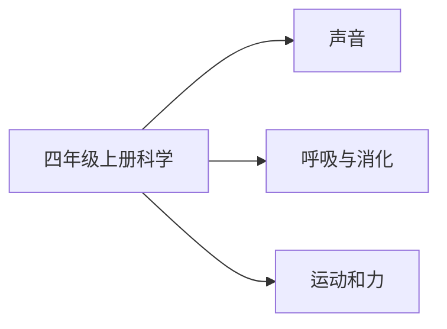

# 四年级上册科学知识图谱（阅读版）

## 1. 来源与分析口径

- 教材：四年级上科学.md。教育科学出版社义务教育教科书
- 课标：（10）义务教育科学课程标准日常修订版（2022年版2025年修订）.md
- 页码：书内页来自教材目录和课题页。这些 Markdown 没有可靠的 PDF 页码，不编造 PDF 页。
- 口径：课次与目录、正文课题一致。对齐状态按该册所在学段的内容要求判断。

## 2. 图谱模型

节点按学科、领域、单元、课次、知识点展开。方法技能、课标要求和核心素养横向连接。
`current_book` 是本册实际出现的内容。`stage_later` 是同学段里本册还没有系统学习的要求。
`standard_missing` 表示没有对应课标文件，不补写课标条文。

## 3. 总体知识图谱

## 4. 教材知识点与课标对齐

| 单元 | 课次 | 知识点 | 课标对齐 | 状态 | 来源 |
|---|---|---|---|---|---|
| 声音 | 听听声音 | 听听声音 | 举例说明声音因物体振动产生，能向各个方向传播，有高低和强弱（direct） | current_book | 四年级上科学.md书内2｜听听声音 |
| 声音 | 声音是怎样产生的 | 声音是怎样产生的 | 举例说明声音因物体振动产生，能向各个方向传播，有高低和强弱（direct） | current_book | 四年级上科学.md书内4｜声音是怎样产生的 |
| 声音 | 声音是怎样传播的 | 声音是怎样传播的 | 举例说明声音因物体振动产生，能向各个方向传播，有高低和强弱（direct） | current_book | 四年级上科学.md书内6｜声音是怎样传播的 |
| 声音 | 我们是怎样听到声音的 | 我们是怎样听到声音的 | 举例说明声音因物体振动产生，能向各个方向传播，有高低和强弱（direct） | current_book | 四年级上科学.md书内9｜我们是怎样听到声音的 |
| 声音 | 声音的强与弱 | 声音的强与弱 | 举例说明声音因物体振动产生，能向各个方向传播，有高低和强弱（direct） | current_book | 四年级上科学.md书内11｜声音的强与弱 |
| 声音 | 声音的高与低 | 声音的高与低 | 举例说明声音因物体振动产生，能向各个方向传播，有高低和强弱（direct） | current_book | 四年级上科学.md书内13｜声音的高与低 |
| 声音 | 让弦发出高低不同的声音 | 让弦发出高低不同的声音 | 举例说明声音因物体振动产生，能向各个方向传播，有高低和强弱（direct） | current_book | 四年级上科学.md书内16｜让弦发出高低不同的声音 |
| 声音 | 制作我的小乐器 | 制作我的小乐器 | 举例说明声音因物体振动产生，能向各个方向传播，有高低和强弱（direct） | current_book | 四年级上科学.md书内18｜制作我的小乐器 |
| 呼吸与消化 | 感受我们的呼吸 | 感受我们的呼吸 | 描述人体用于呼吸和摄取养分的器官，列举保护方法（direct） | current_book | 四年级上科学.md书内21｜感受我们的呼吸 |
| 呼吸与消化 | 呼吸与健康生活 | 呼吸与健康生活 | 描述人体用于呼吸和摄取养分的器官，列举保护方法（direct） | current_book | 四年级上科学.md书内23｜呼吸与健康生活 |
| 呼吸与消化 | 测量肺活量 | 测量肺活量 | 描述人体用于呼吸和摄取养分的器官，列举保护方法（direct） | current_book | 四年级上科学.md书内25｜测量肺活量 |
| 呼吸与消化 | 一天的食物 | 一天的食物 | 描述人体用于呼吸和摄取养分的器官，列举保护方法（direct） | current_book | 四年级上科学.md书内27｜一天的食物 |
| 呼吸与消化 | 食物中的营养 | 食物中的营养 | 描述人体用于呼吸和摄取养分的器官，列举保护方法（direct） | current_book | 四年级上科学.md书内30｜食物中的营养 |
| 呼吸与消化 | 营养要均衡 | 营养要均衡 | 描述人体用于呼吸和摄取养分的器官，列举保护方法（direct） | current_book | 四年级上科学.md书内32｜营养要均衡 |
| 呼吸与消化 | 食物在口腔里的变化 | 食物在口腔里的变化 | 描述人体用于呼吸和摄取养分的器官，列举保护方法（direct） | current_book | 四年级上科学.md书内34｜食物在口腔里的变化 |
| 呼吸与消化 | 食物在身体里的旅行 | 食物在身体里的旅行 | 描述人体用于呼吸和摄取养分的器官，列举保护方法（direct） | current_book | 四年级上科学.md书内37｜食物在身体里的旅行 |
| 运动和力 | 让小车运动起来 | 让小车运动起来 | 用速度描述运动快慢，描述直线和曲线等运动方式，知道测量距离和时间的常用方法（direct） | current_book | 四年级上科学.md书内41｜让小车运动起来 |
| 运动和力 | 用气球驱动小车 | 用气球驱动小车 | 用速度描述运动快慢，描述直线和曲线等运动方式，知道测量距离和时间的常用方法（direct） | current_book | 四年级上科学.md书内44｜用气球驱动小车 |
| 运动和力 | 用橡皮筋驱动小车 | 用橡皮筋驱动小车 | 用速度描述运动快慢，描述直线和曲线等运动方式，知道测量距离和时间的常用方法（direct） | current_book | 四年级上科学.md书内46｜用橡皮筋驱动小车 |
| 运动和力 | 弹簧测力计 | 弹簧测力计 | 用速度描述运动快慢，描述直线和曲线等运动方式，知道测量距离和时间的常用方法（direct） | current_book | 四年级上科学.md书内48｜弹簧测力计 |
| 运动和力 | 运动与摩擦力 | 运动与摩擦力 | 用速度描述运动快慢，描述直线和曲线等运动方式，知道测量距离和时间的常用方法（extension） | current_book | 四年级上科学.md书内51｜运动与摩擦力 |
| 运动和力 | 运动的小车 | 运动的小车 | 用速度描述运动快慢，描述直线和曲线等运动方式，知道测量距离和时间的常用方法（direct） | current_book | 四年级上科学.md书内54｜运动的小车 |
| 运动和力 | 设计制作小车（一） | 设计制作小车（一） | 用速度描述运动快慢，描述直线和曲线等运动方式，知道测量距离和时间的常用方法（direct） | current_book | 四年级上科学.md书内56｜设计制作小车（一） |
| 运动和力 | 设计制作小车（二） | 设计制作小车（二） | 用速度描述运动快慢，描述直线和曲线等运动方式，知道测量距离和时间的常用方法（direct） | current_book | 四年级上科学.md书内58｜设计制作小车（二） |

## 5. 学习进阶与前置关系

本册内部的前后关系体现在单元顺序。跨册进阶写在总图里。

## 6. 跨学科关联

总图把「我们是怎样听到声音的」和四年级语文《夜间飞行的秘密》相连。

## 7. 本册未覆盖的学段后续要求

- 本册未学：电路、导体和绝缘体
- 本册未学：绿色开花植物的一生
- 本册未学：土壤的主要成分

## 8. 结论与限制

科学教材为教育科学出版社义务教育教科书。课标按六三学制 3～4 年级或 5～6 年级内容要求对齐。课次名称取自目录并在正文课题中出现。没有把练习情境写成核心知识点。
