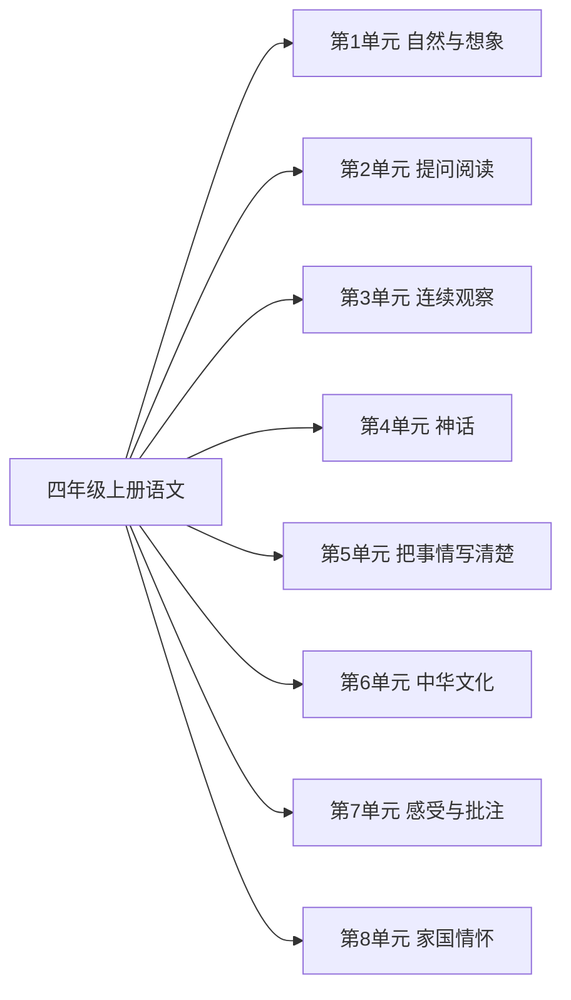

# 四年级上册语文知识图谱（阅读版）

## 1. 来源与分析口径

- 教材：四年级上语文.md。人民教育出版社义务教育教科书
- 课标：（3）义务教育语文课程标准日常修订版（2022年版2025年修订）.md
- 页码：书内页来自教材目录和课题页。这些 Markdown 没有可靠的 PDF 页码，不编造 PDF 页。
- 口径：按本册所在学段对齐。学段里本册尚未系统完成的要求标为 stage_later。

## 2. 图谱模型

节点按学科、领域、单元、课次、知识点展开。方法技能、课标要求和核心素养横向连接。
`current_book` 是本册实际出现的内容。`stage_later` 是同学段里本册还没有系统学习的要求。
`standard_missing` 表示没有对应课标文件，不补写课标条文。

## 3. 总体知识图谱

## 4. 教材知识点与课标对齐

| 单元 | 课次 | 知识点 | 课标对齐 | 状态 | 来源 |
|---|---|---|---|---|---|
| 第1单元 自然与想象 | 观潮 | — | 诵读优秀诗文，展开想象，领悟诗文大意，初步感受生动的形象和优美的语言（partial） | current_book | 四年级上语文.md书内2｜观潮 |
| 第1单元 自然与想象 | 繁星 | — | 诵读优秀诗文，展开想象，领悟诗文大意，初步感受生动的形象和优美的语言（partial） | current_book | 四年级上语文.md书内5｜繁星 |
| 第1单元 自然与想象 | 现代诗二首 | — | 诵读优秀诗文，展开想象，领悟诗文大意，初步感受生动的形象和优美的语言（partial） | current_book | 四年级上语文.md书内7｜现代诗二首 |
| 第1单元 自然与想象 | 口语交际：我们与环境 | — | 诵读优秀诗文，展开想象，领悟诗文大意，初步感受生动的形象和优美的语言（partial） | current_book | 四年级上语文.md书内9｜口语交际：我们与环境 |
| 第1单元 自然与想象 | 习作：推荐一个好地方 | — | 诵读优秀诗文，展开想象，领悟诗文大意，初步感受生动的形象和优美的语言（partial） | current_book | 四年级上语文.md书内10｜习作：推荐一个好地方 |
| 第2单元 提问阅读 | 一个豆荚里的五粒豆 | — | 能对课文中不理解的地方提出疑问，学习圈点、批注（direct） | current_book | 四年级上语文.md书内14｜一个豆荚里的五粒豆 |
| 第2单元 提问阅读 | 夜间飞行的秘密 | — | 能对课文中不理解的地方提出疑问，学习圈点、批注（direct） | current_book | 四年级上语文.md书内19｜夜间飞行的秘密 |
| 第2单元 提问阅读 | 呼风唤雨的世纪 | — | 能对课文中不理解的地方提出疑问，学习圈点、批注（direct） | current_book | 四年级上语文.md书内23｜呼风唤雨的世纪 |
| 第2单元 提问阅读 | 田忌赛马 | — | 能对课文中不理解的地方提出疑问，学习圈点、批注（direct） | current_book | 四年级上语文.md书内26｜田忌赛马 |
| 第2单元 提问阅读 | 习作：小小动物园 | — | 能对课文中不理解的地方提出疑问，学习圈点、批注（direct） | current_book | 四年级上语文.md书内28｜习作：小小动物园 |
| 第3单元 连续观察 | 古诗三首 | — | 学习阅读说明、叙写大自然的短文，用日记、观察手记展示观察收获（direct） | current_book | 四年级上语文.md书内32｜古诗三首 |
| 第3单元 连续观察 | 爬山虎的脚 | — | 学习阅读说明、叙写大自然的短文，用日记、观察手记展示观察收获（direct） | current_book | 四年级上语文.md书内34｜爬山虎的脚 |
| 第3单元 连续观察 | 蟋蟀的住宅 | — | 学习阅读说明、叙写大自然的短文，用日记、观察手记展示观察收获（direct） | current_book | 四年级上语文.md书内37｜蟋蟀的住宅 |
| 第3单元 连续观察 | 习作：写观察日记 | — | 学习阅读说明、叙写大自然的短文，用日记、观察手记展示观察收获（direct） | current_book | 四年级上语文.md书内42｜习作：写观察日记 |
| 第4单元 神话 | 盘古开天地 | — | 未对齐 | current_book | 四年级上语文.md书内46｜盘古开天地 |
| 第4单元 神话 | 精卫填海 | — | 未对齐 | current_book | 四年级上语文.md书内48｜精卫填海 |
| 第4单元 神话 | 普罗米修斯 | — | 未对齐 | current_book | 四年级上语文.md书内49｜普罗米修斯 |
| 第4单元 神话 | 女娲补天 | — | 未对齐 | current_book | 四年级上语文.md书内52｜女娲补天 |
| 第4单元 神话 | 快乐读书吧：很久很久以前 | — | 未对齐 | current_book | 四年级上语文.md书内57｜快乐读书吧：很久很久以前 |
| 第5单元 把事情写清楚 | 麻雀 | — | 观察周围世界，把见闻、感受和想象写清楚（partial） | current_book | 四年级上语文.md书内60｜麻雀 |
| 第5单元 把事情写清楚 | 爬天都峰 | — | 观察周围世界，把见闻、感受和想象写清楚（partial） | current_book | 四年级上语文.md书内63｜爬天都峰 |
| 第5单元 把事情写清楚 | 习作：生活万花筒 | — | 观察周围世界，把见闻、感受和想象写清楚（partial） | current_book | 四年级上语文.md书内70｜习作：生活万花筒 |
| 第6单元 中华文化 | 长城 | — | 未对齐 | current_book | 四年级上语文.md书内72｜长城 |
| 第6单元 中华文化 | 颐和园 | — | 未对齐 | current_book | 四年级上语文.md书内75｜颐和园 |
| 第6单元 中华文化 | 秦兵马俑 | — | 未对齐 | current_book | 四年级上语文.md书内78｜秦兵马俑 |
| 第6单元 中华文化 | 口语交际：我是小小讲解员 | — | 未对齐 | current_book | 四年级上语文.md书内80｜口语交际：我是小小讲解员 |
| 第6单元 中华文化 | 习作：中国的世界文化遗产 | — | 未对齐 | current_book | 四年级上语文.md书内81｜习作：中国的世界文化遗产 |
| 第7单元 感受与批注 | 牛和鹅 | — | 能对课文中不理解的地方提出疑问，学习圈点、批注（direct） | current_book | 四年级上语文.md书内86｜牛和鹅 |
| 第7单元 感受与批注 | 一只窝囊的大老虎 | — | 能对课文中不理解的地方提出疑问，学习圈点、批注（direct） | current_book | 四年级上语文.md书内91｜一只窝囊的大老虎 |
| 第7单元 感受与批注 | 王戎不取道旁李 | — | 能对课文中不理解的地方提出疑问，学习圈点、批注（direct） | current_book | 四年级上语文.md书内96｜王戎不取道旁李 |
| 第7单元 感受与批注 | 陀螺 | — | 能对课文中不理解的地方提出疑问，学习圈点、批注（direct） | current_book | 四年级上语文.md书内97｜陀螺 |
| 第7单元 感受与批注 | 习作：我的心儿怦怦跳 | — | 能对课文中不理解的地方提出疑问，学习圈点、批注（direct） | current_book | 四年级上语文.md书内102｜习作：我的心儿怦怦跳 |
| 第8单元 家国情怀 | 古诗三首 | — | 未对齐 | current_book | 四年级上语文.md书内106｜古诗三首 |
| 第8单元 家国情怀 | 为中华之崛起而读书 | — | 未对齐 | current_book | 四年级上语文.md书内108｜为中华之崛起而读书 |
| 第8单元 家国情怀 | 梅兰芳蓄须明志 | — | 未对齐 | current_book | 四年级上语文.md书内111｜梅兰芳蓄须明志 |
| 第8单元 家国情怀 | 延安，我把你追寻 | — | 未对齐 | current_book | 四年级上语文.md书内116｜延安，我把你追寻 |
| 第8单元 家国情怀 | 习作：写信 | — | 未对齐 | current_book | 四年级上语文.md书内118｜习作：写信 |

## 5. 学习进阶与前置关系

本册内部的前后关系体现在单元顺序。跨册进阶写在总图里。

## 6. 跨学科关联

跨学科边只在总图中建立，且只连接教材内容确实相关的课。

## 7. 本册未覆盖的学段后续要求

- 本册未单列完成：累计认识常用汉字2500个左右，其中1600个左右会写
- 本册未系统教学：能用音序检字法和部首检字法查字典、词典
- 本册未系统教学：用毛笔临摹正楷字帖
- 本册未系统教学：学习略读，粗知文章大意
- 本册未系统教学：能复述叙事性作品的大意
- 本册未完成学段整本书要求：阅读整本书，初步理解主要内容
- 本册未核验：课外阅读总量不少于40万字
- 本册未系统教学：学习修改习作中有明显错误的词句
- 本册未系统教学：尝试分类整理学过的字词

## 8. 结论与限制

语文课标是 2022 年版、2025 年修订。四年级上对齐第二学段（3～4年级），五、六年级上对齐第三学段（5～6年级）。学段要求跨学期，本册没有系统安排的条目标为 stage_later，不写成已经掌握。知识点仍只采用教材单元导语和课题里写出的学习要求。六年级文言文相对第三学段最低要求标为 extension。
