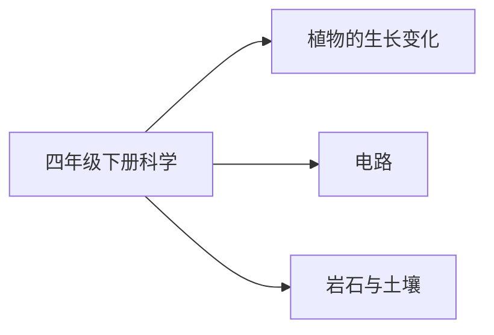

# 四年级下册科学知识图谱（阅读版）

## 1. 来源与分析口径

- 教材：四年级下科学.md。教育科学出版社义务教育教科书
- 课标：（10）义务教育科学课程标准日常修订版（2022年版2025年修订）.md
- 页码：书内页来自教材目录和课题页。这些 Markdown 没有可靠的 PDF 页码，不编造 PDF 页。
- 口径：课次与目录、正文课题一致。对齐状态按该册所在学段的内容要求判断。

## 2. 图谱模型

节点按学科、领域、单元、课次、知识点展开。方法技能、课标要求和核心素养横向连接。
`current_book` 是本册实际出现的内容。`stage_later` 是同学段里本册还没有系统学习的要求。
`standard_missing` 表示没有对应课标文件，不补写课标条文。

## 3. 总体知识图谱

## 4. 教材知识点与课标对齐

| 单元 | 课次 | 知识点 | 课标对齐 | 状态 | 来源 |
|---|---|---|---|---|---|
| 植物的生长变化 | 种子里孕育着新生命 | 种子里孕育着新生命 | 描述植物由根、茎、叶、花、果实和种子构成，说出植物通过种子或根茎叶繁殖（direct） | current_book | 四年级下科学.md书内2｜种子里孕育着新生命 |
| 植物的生长变化 | 种植凤仙花 | 种植凤仙花 | 描述植物由根、茎、叶、花、果实和种子构成，说出植物通过种子或根茎叶繁殖（direct） | current_book | 四年级下科学.md书内4｜种植凤仙花 |
| 植物的生长变化 | 种子长出了根 | 种子长出了根 | 描述植物由根、茎、叶、花、果实和种子构成，说出植物通过种子或根茎叶繁殖（direct） | current_book | 四年级下科学.md书内7｜种子长出了根 |
| 植物的生长变化 | 茎和叶 | 茎和叶 | 描述植物由根、茎、叶、花、果实和种子构成，说出植物通过种子或根茎叶繁殖（direct） | current_book | 四年级下科学.md书内10｜茎和叶 |
| 植物的生长变化 | 凤仙花开花了 | 凤仙花开花了 | 描述植物由根、茎、叶、花、果实和种子构成，说出植物通过种子或根茎叶繁殖（direct） | current_book | 四年级下科学.md书内13｜凤仙花开花了 |
| 植物的生长变化 | 果实和种子 | 果实和种子 | 描述植物由根、茎、叶、花、果实和种子构成，说出植物通过种子或根茎叶繁殖（direct） | current_book | 四年级下科学.md书内15｜果实和种子 |
| 植物的生长变化 | 种子的传播 | 种子的传播 | 描述植物由根、茎、叶、花、果实和种子构成，说出植物通过种子或根茎叶繁殖（direct） | current_book | 四年级下科学.md书内17｜种子的传播 |
| 植物的生长变化 | 凤仙花的一生 | 凤仙花的一生 | 描述植物由根、茎、叶、花、果实和种子构成，说出植物通过种子或根茎叶繁殖（direct） | current_book | 四年级下科学.md书内19｜凤仙花的一生 |
| 电路 | 电和我们的生活 | 电和我们的生活 | 知道电源、导线、用电器和开关是构成电路的必要元件，区分导体和绝缘体（direct） | current_book | 四年级下科学.md书内22｜电和我们的生活 |
| 电路 | 点亮小灯泡 | 点亮小灯泡 | 知道电源、导线、用电器和开关是构成电路的必要元件，区分导体和绝缘体（direct） | current_book | 四年级下科学.md书内24｜点亮小灯泡 |
| 电路 | 简易电路 | 简易电路 | 知道电源、导线、用电器和开关是构成电路的必要元件，区分导体和绝缘体（direct） | current_book | 四年级下科学.md书内26｜简易电路 |
| 电路 | 电路出故障了 | 电路出故障了 | 知道电源、导线、用电器和开关是构成电路的必要元件，区分导体和绝缘体（direct） | current_book | 四年级下科学.md书内29｜电路出故障了 |
| 电路 | 里面是怎样连接的 | 里面是怎样连接的 | 知道电源、导线、用电器和开关是构成电路的必要元件，区分导体和绝缘体（direct） | current_book | 四年级下科学.md书内31｜里面是怎样连接的 |
| 电路 | 导体和绝缘体 | 导体和绝缘体 | 知道电源、导线、用电器和开关是构成电路的必要元件，区分导体和绝缘体（direct） | current_book | 四年级下科学.md书内33｜导体和绝缘体 |
| 电路 | 电路中的开关 | 电路中的开关 | 知道电源、导线、用电器和开关是构成电路的必要元件，区分导体和绝缘体（direct） | current_book | 四年级下科学.md书内36｜电路中的开关 |
| 电路 | 模拟安装照明电路 | 模拟安装照明电路 | 知道电源、导线、用电器和开关是构成电路的必要元件，区分导体和绝缘体（direct） | current_book | 四年级下科学.md书内39｜模拟安装照明电路 |
| 岩石与土壤 | 岩石与土壤的故事 | 岩石与土壤的故事 | 知道土壤的主要成分，观察并描述砂质土、黏质土、壤质土的特点（direct） | current_book | 四年级下科学.md书内42｜岩石与土壤的故事 |
| 岩石与土壤 | 认识几种常见的岩石 | 认识几种常见的岩石 | 知道土壤的主要成分，观察并描述砂质土、黏质土、壤质土的特点（direct） | current_book | 四年级下科学.md书内44｜认识几种常见的岩石 |
| 岩石与土壤 | 岩石的组成 | 岩石的组成 | 知道土壤的主要成分，观察并描述砂质土、黏质土、壤质土的特点（extension） | current_book | 四年级下科学.md书内47｜岩石的组成 |
| 岩石与土壤 | 制作岩石和矿物标本 | 制作岩石和矿物标本 | 知道土壤的主要成分，观察并描述砂质土、黏质土、壤质土的特点（extension） | current_book | 四年级下科学.md书内50｜制作岩石和矿物标本 |
| 岩石与土壤 | 岩石、沙和黏土 | 岩石、沙和黏土 | 知道土壤的主要成分，观察并描述砂质土、黏质土、壤质土的特点（direct） | current_book | 四年级下科学.md书内52｜岩石、沙和黏土 |
| 岩石与土壤 | 观察土壤 | 观察土壤 | 知道土壤的主要成分，观察并描述砂质土、黏质土、壤质土的特点（direct） | current_book | 四年级下科学.md书内54｜观察土壤 |
| 岩石与土壤 | 比较不同的土壤 | 比较不同的土壤 | 知道土壤的主要成分，观察并描述砂质土、黏质土、壤质土的特点（direct） | current_book | 四年级下科学.md书内56｜比较不同的土壤 |
| 岩石与土壤 | 岩石、土壤和我们 | 岩石、土壤和我们 | 知道土壤的主要成分，观察并描述砂质土、黏质土、壤质土的特点（direct） | current_book | 四年级下科学.md书内58｜岩石、土壤和我们 |

## 5. 学习进阶与前置关系

本册内部的前后关系体现在单元顺序。跨册进阶写在总图里。

## 6. 跨学科关联

岩石由矿物组成超出 3～4 年级最低要求，对应 5～6 年级岩石与矿物，因此标为 extension。

## 7. 本册未覆盖的学段后续要求

- 本册未学：声音的产生、传播、高低和强弱
- 本册未学：用仪器测量气温、风力、风向和降水量

## 8. 结论与限制

科学教材为教育科学出版社义务教育教科书。课标按六三学制 3～4 年级或 5～6 年级内容要求对齐。课次名称取自目录并在正文课题中出现。没有把练习情境写成核心知识点。
